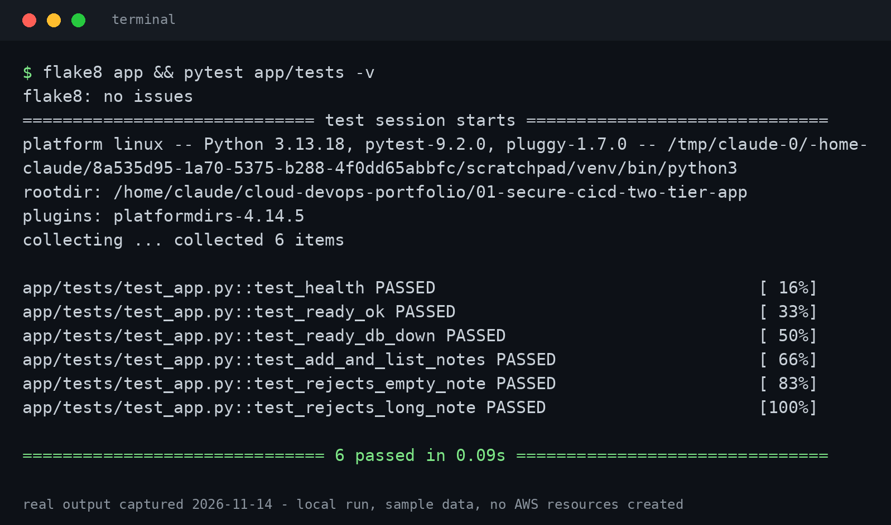

# Secure CI/CD for a Two-Tier App

> **Author:** LingarajH · **LinkedIn:** [lingaraj-h](https://www.linkedin.com/in/lingaraj-h-a3a7b3404/) · **GitHub:** [LingarajH-011](https://github.com/LingarajH-011)
> Standalone repo: everything needed to run it is in this folder. It costs nothing to run on a machine you already have.

A Flask + MySQL application with a GitHub Actions pipeline that lints, tests, builds a hardened
Docker image, scans it with Trivy and can deploy to a test server.

> Replace `app/app.py` with your own Flask application if you like. Keep the `/health` and `/ready`
> endpoints and the pipeline will still work.

## Problem statement

Shipping code by hand is slow and risky: untested changes, vulnerable base images and unclear rollback
steps. This project automates quality and security checks on every push.

## Requirements

| Tool | Needed for | Install (Amazon Linux 2023) |
|------|-----------|-----------------------------|
| Docker + Compose plugin | Running the app | `sudo dnf install -y docker git && sudo systemctl enable --now docker && sudo usermod -aG docker $USER` (log out/in), then add the [Compose plugin](https://docs.docker.com/compose/install/linux/) |
| Python 3.12+ | Running lint/tests outside Docker | `sudo dnf install -y python3 python3-pip` |
| Trivy (optional) | Local image scan | [Install guide](https://trivy.dev/latest/getting-started/installation/) |

No AWS account and no paid service is needed.

## Architecture

```
 Developer ──push──▶ GitHub ──▶ GitHub Actions
                                  │ 1. flake8 + pytest
                                  │ 2. docker build
                                  │ 3. Trivy scan (fails on HIGH/CRITICAL)
                                  │ 4. (manual) SSH deploy
                                  ▼
                         Linux server / EC2
                      ┌───────────────────────┐
        :5000 ───────▶│ app (Flask+gunicorn)  │
                      │   non-root, read-only │
                      └──────────┬────────────┘
                                 │ private network "backend"
                      ┌──────────▼────────────┐
                      │ db (MySQL 8) volume   │  not exposed to host
                      └───────────────────────┘
```

Draw your own version of this diagram (draw.io / Excalidraw) and save it as
`docs/architecture.png`.

## Run it locally

```bash
cp .env.example .env          # edit the passwords
docker compose up -d --build
curl localhost:5000/health
curl localhost:5000/ready
curl -X POST localhost:5000/notes -H 'Content-Type: application/json' -d '{"text":"first note"}'
curl localhost:5000/notes
```

Run tests without Docker:

```bash
python3 -m venv .venv && source .venv/bin/activate
pip install -r app/requirements-dev.txt
flake8 app --max-line-length=100
pytest app/tests -q
```

Scan the image locally:

```bash
trivy image --severity HIGH,CRITICAL --ignore-unfixed two-tier-app:local
```

## Security decisions

| Decision | Why |
|----------|-----|
| Non-root user in Dockerfile | Limits damage if the app is compromised |
| `read_only`, `cap_drop: ALL`, `no-new-privileges` in Compose | Reduces container attack surface |
| MySQL not published to the host | Only the app can talk to the database |
| Secrets via `.env` (git-ignored) | No credentials in the repo |
| Parameterised SQL + input validation | Prevents SQL injection |
| Pinned dependency versions | Reproducible, reviewable builds |
| Trivy gate in CI | Blocks known HIGH/CRITICAL vulnerabilities with fixes |
| Pipeline has `contents: read` only | Least privilege for the CI token |

## Deploy and rollback

- Deploy: `bash scripts/deploy.sh` builds, starts and waits for `/ready`, then records the commit.
- Rollback: `bash scripts/rollback.sh` restores the previous successful commit's files and redeploys.
  Pass a specific commit hash to go back further.
- CI deploy: run the workflow manually and tick **deploy** (needs `DEPLOY_HOST`, `DEPLOY_USER`,
  `DEPLOY_SSH_KEY` repo secrets).

## Troubleshooting examples (add your own real ones)

| Symptom | Cause | Fix |
|---------|-------|-----|
| `app` restarts, logs say "Can't connect to MySQL" | App started before DB ready | Compose `depends_on: service_healthy` (already set) |
| `Read-only file system` error | `read_only: true` and app writes to disk | Mount a `tmpfs` for the path it writes to |
| Trivy fails the pipeline | New CVE in base image | Bump the base image tag or `pip` package and rebuild |

## Cost

Free locally. An EC2 `t3.micro` is optional if you want to demo a real deployment; stop it afterwards.

## Cleanup

```bash
docker compose down -v
docker image rm two-tier-app:local
```

## What I would improve in production

- Push images to a registry (ECR) with immutable tags and sign them (cosign)
- Use a managed database (RDS) with encryption and backups instead of a container
- Add HTTPS via a reverse proxy / load balancer
- Store secrets in AWS Secrets Manager
- Add SAST and dependency scanning (CodeQL, Dependabot)

## Output

Real output of the lint and test step, captured locally (see `tools/make_evidence.sh`):



## Evidence still to add (screenshots/)

- [ ] Green GitHub Actions run
- [ ] Trivy report
- [ ] App responding on `/health`
- [ ] `docker ps` showing healthy containers
